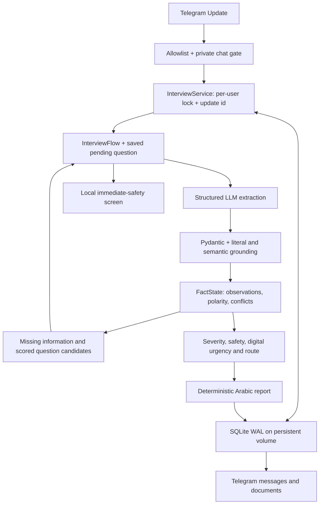

# ACCP.AI architecture

The original project is evolved in place. `engine.py` remains a public facade for Session, QA, next_question, assess and assemble_report. Existing test files are preserved byte-for-byte.

## Modules

| Responsibility | Files |
|---|---|
| Configuration and startup | config.py, docker_entrypoint.py, worker_lock.py |
| Domain schema and session serialization | domain.py |
| Provider transport and extraction | cloud_llm.py, nlp.py |
| Arabic normalization, scope, semantic validation | arabic_semantics.py, grounding.py |
| Classification compatibility and current state | classification_backstop.py, fact_state.py |
| Time and event confirmation | timeline.py |
| Question planning | interview_planner.py |
| Transparent priority assessment | risk.py |
| Reports and file serialization | reporting.py, storage.py |
| Conversation and async orchestration | bot_flow.py, service.py |
| Telegram and CLI | telegram_bot.py, main.py |
| Persistence and maintenance | persistence.py, manage_data.py |

## Facts and semantic trust

Each grounded observation contains kind, polarity, source, quote, character start/end, fact_id, event_id, temporal_context, extraction_method and verification=`unverified`. Pydantic validates enum values/types. No component can claim external verification. Short yes/no answers derive their meaning only from the persisted actual question.

LLM output is a proposal. Its exact quote must exist in a uniquely identified source. Local semantic rules validate the kind and polarity in context; unknown semantic proposals are quarantined rather than promoted into risk. This is deliberately conservative and means the hosted model cannot bypass limited rule coverage. Novel phrasings may require human review even if a model recognizes them. This is **not** a general Arabic semantic entailment model.

Normalization strips diacritics only for matching; offsets map back to original characters. Negation follows the nearest local marker; adversatives and recognized independent conjunct predicates terminate scope. Conditions and future threats do not establish completed payment/publication. Double negation is marked uncertain. Observations are preserved; explicit temporal updates can supersede an earlier state, while unresolved conflicting reports are marked for clarification.

## Planner

`FactState → MissingInformation → CandidateQuestions → utility ordering → StopDecision`

Each candidate has a target slot, impact, uncertainty, burden, reason and wording. Utility = impact × uncertainty − burden. These are engineering priorities, **not calibrated expected probabilities or measured entropy**. Safety questions require a relevant trigger. Covered slots and prior question keys suppress repeats; a documented new serious safety revision may permit a recheck. The planner stops at sufficient information or six answers. The selected key, text, id and safety revision are persisted before any answer is accepted.

## Risk and routes

The highest supported complaint weight establishes the base. Correlated generic harm/financial loss/injury factors share a bucket; recurrence and renewed threat do not stack; the latest near deadline replaces the old deadline weight. Contributions sum to the capped score. Unsupported/conflicting information cannot silently justify a precise score. Serious threat review priority survives absent injury and extraction failure.

The public UI uses `recommended_route`: assisted_resolution, information_only, additional_information_required, standard_human_review, priority_human_review, immediate_safety_guidance. Draft availability is an explicit consent workflow, not a replacement for the safety route. Legacy `risk.route` remains for compatibility; its mapping is in risk.py.

## Persistence and failure semantics

SQLite WAL + synchronous FULL stores one current flow per authorized user, optimistic revision and message ordering. A transaction saves both the revised session and an outgoing result before Telegram delivery. Successful delivery removes response content while retaining a dedup tombstone. A failed delivery can be replayed for the same update; `/status` and `/report` recover saved state/documents. Delivery is at-least-once: a crash after Telegram accepts a message but before the delivered mark can duplicate output. Exactly-once network delivery is not claimed. An in-flight update that crashes before commit may need resending.

Different users run concurrently, bounded by a semaphore for LLM work; same-user updates serialize. Arrival revisions prevent two rapidly queued answers from binding to unseen questions. Singleton file locking protects one local data directory; deployments on different disks with the same Telegram token still require operational single-instance discipline.

Retention defaults to 24 hours since the latest session access/change. Purging runs on startup, update processing and hourly while running. `/reset` erases complaint content and keeps dedup metadata until expiry. SQLite is not encrypted. CLI exported reports are separate files and require manual deletion.

## Cost and provider behavior

One extraction call per substantial turn, no separate final summary call, and no model call for bare yes/no/unknown. JSON Schema falls back to JSON Object only on an explicit unsupported-format error. At most three attempts, bounded per-request connect/read timeouts and exponential backoff. Authentication/configuration errors are not retried. Provider text/errors/keys are not logged.

CLI uses the same InterviewFlow. Ollama remains an optional legacy CLI path via requirements-ollama.txt, not a Railway dependency.
